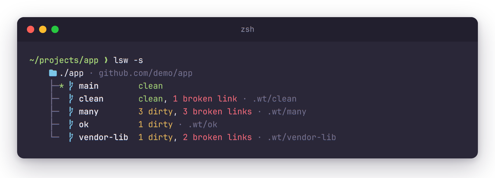
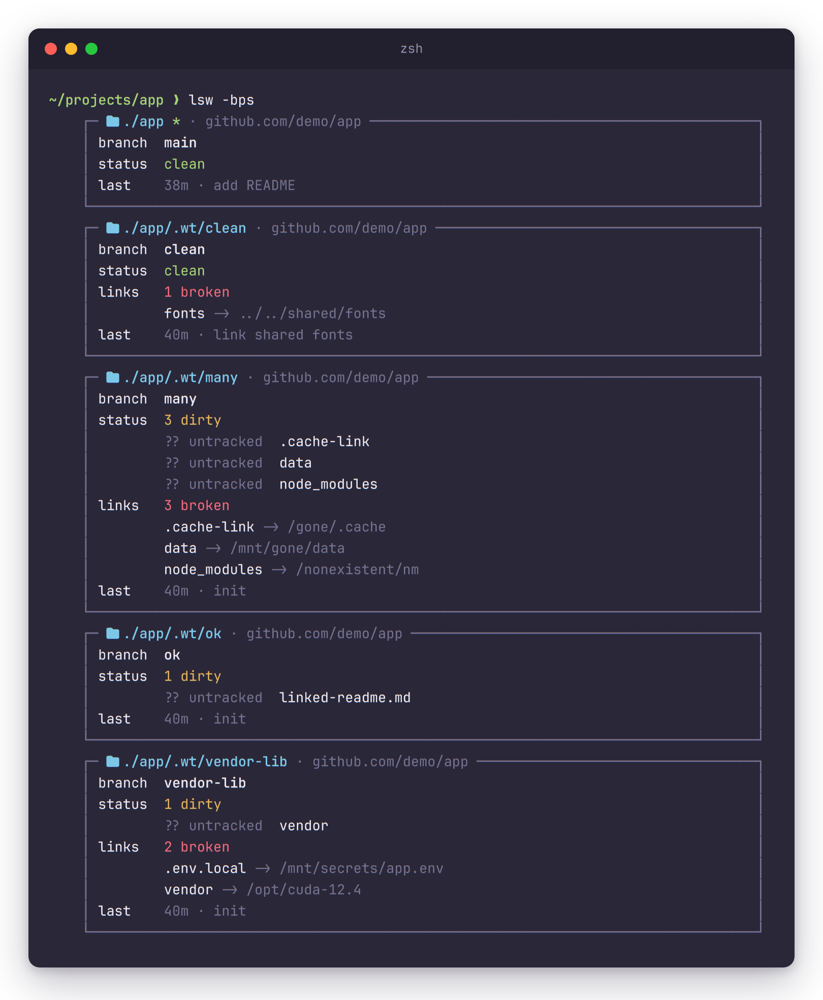

# lsw

<p align="center"></p>

**`ls` for git worktrees.** One command to see every worktree you have — which
branch it holds, whether it is dirty, and how far it drifted from the remote.

Built for the "each task gets its own worktree" workflow: instead of
`cd`-ing around and running `git status` five times, run `lsw` once in your
projects folder — or anywhere inside a repo, a subdirectory or a linked
worktree is enough.

## Why

- **Read-only.** No state, no config, no daemon. It never touches your repos.
- **Zero dependencies.** A single static binary: Rust std + the `git` you
  already have. No libgit2, no OpenSSL, nothing to audit.
- **Fast.** One `git worktree list` and one `git status` per worktree — that's
  the whole I/O (`-s` adds one top-level symlink scan per worktree).
- **Single purpose.** It lists. Creation, pruning and branch management are
  deliberately out of scope — `git worktree` itself does that well.

Fits the [Omarchy](https://omarchy.org) philosophy: small sharp tools that
compose.

## Install

```sh
# install script (latest prebuilt binary, x86_64-linux)
curl -fsSL https://raw.githubusercontent.com/apilot/lsw/main/install.sh | sh

# or from crates.io (package name `ls-worktrees`, the command is `lsw`)
cargo install ls-worktrees

# or build from source (any platform with Rust + git)
cargo install --git https://github.com/apilot/lsw
```

or build from a local checkout:

```sh
cargo install --path .
```

Requires: any OS with `git` in `PATH`. Rust 1.70+ to build. The install
script downloads a release binary, verifies its sha256 and puts `lsw`
into `~/.local/bin` (override with `LSW_PREFIX`).

## Usage

Run inside a repository — from its root, any subdirectory or a linked
worktree — to list **its** worktrees, or inside any folder to
scan repositories one level deep (`-2` / `-3` to look deeper):

```sh
lsw            # tree view
lsw -b         # blocks: full-width cards with more fields
lsw -bp        # + breakdown of what exactly is dirty
lsw -s         # + broken symlink check in worktree roots
lsw -2         # tree view, scanning subdirectories two levels deep
```

`-b` switches to block cards with the remote tracking branch;
`-bp` spells out the dirty state file by file, with +added/−deleted counts,
and adds the last commit:

<p align="center"></p>
<p align="center"></p>

`-s` checks the top level of each worktree root for symlinks whose target is
gone — a dropped mount, a moved external library, a missing secrets file.
`git status` says nothing about those; `lsw -s` marks them with a red
`N broken links` token. With `-bps` every broken link is listed with the
target it points to:

<p align="center"></p>
<p align="center"></p>

### Reading the output

| Token | Meaning |
|---|---|
| `./repo · host/user/repo` | group/card header: folder path and the origin remote in compact form (shown when the repository has an `origin`) |
| `· .wt/name`, `· ../name` | linked worktree directory — nested inside the repository folder / sitting beside it |
| `*` (green) | the worktree you are currently in |
| `N dirty` | uncommitted changes (yellow) |
| `clean` | no changes (green) |
| `↑N` | ahead of upstream by N commits (cyan) |
| `↓N` | behind upstream by N commits (red) |
| `no upstream` | branch has no remote tracking |
| `upstream gone` | remote branch was deleted |
| `N broken links` | symlink(s) in the worktree root whose target is gone (red, with `-s`) |
| `links   N broken` | block card field carrying the same broken-symlink count (with `-s`); `-bps` lists each below as `name -> target` |
| `bare` | bare repository entry |

### Flags

When nothing is found, `lsw` prints a short notice — where it looked, how deep,
how many directories were unreadable — and exits 0. `--debug` lists skipped
locations and per-repo errors.

| Flag | Effect |
|---|---|
| `-b` | block/card layout with branch, status and remote |
| `-p` | with `-b`: per-file dirty breakdown with +/− counts, plus the last commit and the broken symlink list (with `-s`) |
| `-s` | report broken symlinks in worktree roots (top-level entries only) |
| `-2`, `-3` | scan subdirectories deeper (default depth 1). Repos found deeper are labelled by their nesting path (`team/webapp`); worktrees of an already-listed repo are not duplicated |
| `--debug` | show per-repo errors on stderr; stale/broken repos are skipped silently otherwise |
| `--no-icons` | disable Nerd Font glyphs |
| `-v`, `-V`, `--version` | print version |
| `-h`, `--help` | list all flags |

Environment: `NO_COLOR` and `NO_ICONS` force plain output. Output is
ANSI-colored only in a TTY — safe to pipe into `grep`/`fzf`.

## Notes

- Inside a repository the output anchors to its main worktree: from any
  subdirectory or linked worktree you get the same family
  `git worktree list` shows from there.
- Linked worktrees are recognized: ones nested inside their repository fold
  under its header and are not listed twice; sibling worktrees sitting
  beside the repository get their own groups — nothing disappears.
- Deep scans (`-2`/`-3`) don't descend into hidden directories,
  `node_modules` or `target`; stale worktrees (their `.git` points to a
  vanished repository) are skipped too.
- Nerd Font glyphs degrade gracefully without one; use `--no-icons` if you
  prefer plain ASCII.

## License

[MIT](LICENSE)
